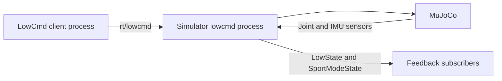
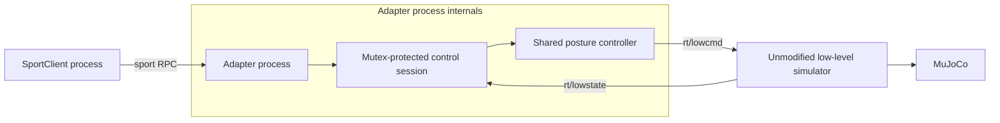
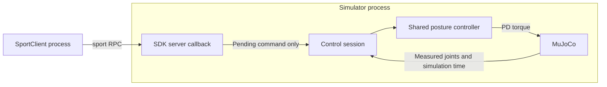

# Go2 StandUp/StandDown Service Deployments

Implementation completed: 2026-10-19
Status: Implemented and verified
Implementation commits: **Uncommitted**. No implementation commit or push was requested in this phase.

## 1. Requirements and Outcome

Preserve direct LowCmd control and support actual SDK SportClient StandUp/StandDown through both an external adapter process and an in-process simulator server. Validate real joint motion rather than treating an RPC response as proof of motion. Keep permanent documentation sufficient for maintenance and remove transient req/plan/wip after completion.

| Requirement | Final behavior and evidence |
| --- | --- |
| R1 | Existing interactive LowCmd behavior and positional network argument preserved. Finite/noninteractive options added. Interactive CLI compatibility and physical LowCmd control tested. |
| R2 | Client selects lowcmd/sport and standup/standdown/sequence, domain/network, automatic startup, and duration. Sport mode creates no LowCmd writer. |
| R3 | Simulator selects lowcmd/sport, defaults to lowcmd, and accepts old YAML without a control key. Sport rejects non-Go2, HG, and wrong actuator counts. Sensorless models are rejected before bridge access. |
| R4 | Standalone go2_sport_adapter runs with an ordinary low-level simulator. Tested with both the current and the preserved original simulator. |
| R5 | Shared SDK Server exposes sport version 1.0.0.1, API 1004 StandUp and 1005 StandDown. Unsupported response-based actions return 3203. |
| R6 | RPC 0 means accepted. Clients report errors and exit unsuccessfully. Actual LowState/position telemetry determines physical success. |
| R7 | Both services share original Go2 12-joint targets, 2-second smoothstep, kp=50, kd=3.5, zero target velocity/feedforward torque, and target holding. |
| R8 | New/repeated commands restart from measured posture; the last pending accepted request wins. Shared state is mutex-protected. Reversal tested. |
| R9 | Adapter rejects requests and publishes no control before valid feedback. At 500ms stale feedback it stops publishing, returns 3202, and requires a new command after recovery. Actual DDS/RPC tests passed. |
| R10 | Internal controller uses simulation time, freezes on pause, clears commands/torque on backwards reset, and starts fresh after bridge/model recreation. Real model/bridge lifecycle tests passed. |
| R11 | External controller uses a monotonic wall clock. Physical checks ran without pausing; external pause semantics intentionally differ from internal control. |
| R12 | External LowCmd uses SDK-compatible header/motor mode/CRC and a 2ms loop. Internal control follows physics updates. No hard real-time scheduling guarantee. |

Only Go2 simulation posture control is implemented. Other Sport motions, other robots' Sport APIs, and the physical robot's proprietary locomotion/balance controller are outside scope. GO/HG lowcmd paths remain supported.

## 2. Final Architecture

### Existing Direct Control: Two Processes



### External Adapter: Three Processes



### Internal Server: Two Processes



These are alternative deployments. Use one sport server per DDS domain. Do not run the adapter and internal server together in the same domain. In lowcmd mode, use only one LowCmd writer; there is no automatic arbitration between writers. In internal sport mode the simulator does not subscribe to external LowCmd, so an external writer cannot override the service controller.

The SDK handles `rt/api/sport/request` and `rt/api/sport/response`; the server must be instantiated, initialized, and started explicitly. Linking the SDK does not start this application service.

## 3. Implementation and Maintenance Map

| Component | Role and future modification point |
| --- | --- |
| [Posture controller](../../common/go2_posture_controller.h) | Up/down target arrays, smoothstep interpolation, transition duration and target holding. |
| [Control session](../../common/go2_control_session.h) | Thread-safe feedback/command transfer, freshness, reversal, pause/time-reset state. |
| [Sport server](../../common/go2_sport_server.h) | SDK service/version registration, accepted API IDs, callback dispatch and worker shutdown. |
| [LowCmd helper](../../common/go2_lowcmd.h) | Adapter message initialization, gains, motor mode and CRC. |
| [Application options](../../common/go2_options.h) | Example/adapter CLI, defaults, validation and stop signals. |
| [Client example](../../example/cpp/stand_go2.cpp) | Actual SportClient calls and original LowCmd control path. |
| [External adapter](../../example/cpp/go2_sport_adapter.cpp) | LowState subscription, service ownership, wall-clock control loop and LowCmd publication. |
| [Simulator bridge](../../simulate/src/unitree_sdk2_bridge.h) | Internal service ownership, measured joint input, PD application, state publication and model validation. |
| [Simulator entrypoint](../../simulate/src/main.cc) | Physics ownership, GUI mutex, model reload, headless loop and shutdown. |
| [Simulator configuration](../../simulate/src/param.h) | Control/IDL validation, optional YAML control key, headless/duration CLI. |
| [Runtime runner](../../tests/run_go2_sport_modes.py) | Process isolation, telemetry sampling, independent posture oracle, thresholds, evidence and cleanup. |

The legacy direct example intentionally retains its tanh trajectory, gain blend and 3-second switch to StandDown. The service sequence waits 6 seconds before StandDown and uses the shared smoothstep controller. If changing targets for all modes, also update the legacy example's arrays and the independent test oracle; changing the shared service targets alone does not change the legacy example.

For a new service motion, add its actual controller behavior and API handler together, then extend both deployment and physical-feedback tests. Merely registering an API or including a header does not implement motion. Other robot services additionally require IDL/model validation and robot-specific joint mapping; do not enable them by removing the Go2 guard alone.

### Ownership and Shutdown

Service callbacks touch only the control session, never MuJoCo data. The GUI physics owner runs bridge updates under the existing simulation mutex, and the headless path owns its data directly. Model reload destroys the old service/bridge before freeing data and creates a new bridge for the replacement model.

The adapter's feedback callback, main loop and SDK request worker share mutex-protected session state. The service stops its worker before callback-owned state is destroyed; feedback channels close before session destruction. The legacy publisher uses an explicitly joined standard thread, avoiding detached-thread cancellation during finite runs.

## 4. Build and Run

Run from the repository root with the existing SDK2/MuJoCo dependencies installed:

```sh
cmake -S simulate -B simulate/build
cmake --build simulate/build -j2
cmake -S example/cpp -B example/cpp/build
cmake --build example/cpp/build -j2
```

Use separate terminals for each process below, and stop one configuration before starting another. Commands use isolated domain 71 and loopback; keep both values consistent across participants.

```sh
# Direct LowCmd: two terminals
simulate/build/unitree_mujoco --control lowcmd -r go2 -i 71 -n lo
example/cpp/build/stand_go2 --api lowcmd --action sequence --auto --duration 12 --domain 71 --network lo

# External adapter: three terminals
simulate/build/unitree_mujoco --control lowcmd -r go2 -i 71 -n lo
example/cpp/build/go2_sport_adapter --domain 71 --network lo
example/cpp/build/stand_go2 --api sport --action sequence --auto --duration 12 --domain 71 --network lo

# Internal server: two terminals
simulate/build/unitree_mujoco --control sport -r go2 -i 71 -n lo
example/cpp/build/stand_go2 --api sport --action sequence --auto --duration 12 --domain 71 --network lo
```

Use `--action standup` or `--action standdown` for individual actions. Omit `--auto` for the Enter prompt. Omit example/adapter duration for an indefinite run. Default client/adapter DDS settings are domain 1 and lo; a legacy positional interface selects domain 0 unless an explicit domain overrides it.

The simulator accepts optional YAML `control`, defaults to lowcmd when absent, and allows CLI override. Add `--headless` for display-free execution and optionally `--duration SECONDS` for automatic exit. Headless and adapter processes handle Ctrl+C/SIGTERM. The headless path uses XML scenes and the same bridge/model/physics; the optional GUI elastic band is not applied there. Configure the C++ example with `-DBUILD_TESTING=OFF` to build just the applications without the MuJoCo integration-test dependency.

## 5. Verification Evidence

Environment: Linux x86_64, GNU C++ 13.3.0, C++17, MuJoCo 3.3.6, installed SDK2 archive, default `unitree_robots/go2/scene.xml`, loopback. Runtime matrix domain: 71. GUI/internal check: 75. CTest service/lifecycle/interactive-CLI isolation uses domains 72/74/76.

SDK archive SHA-256: `08402aea74150dfbfc3fbfded4ca746916a8d892b54d2bade0cbf392a3be4029`.
Final simulator SHA-256: `b24dfd677279d7d9e7757087c29b3463521d082caa6ffff3a828312cecb15590`.
Preserved original simulator SHA-256: `ab59df04b2ea8c07c27ec3332c0ae2e29cf98e65dc2f06828fa33dd4349076bd`.

### Builds and Test Suite

- Simulator and example/adapter builds: PASS.
- Applications-only `BUILD_TESTING=OFF` build: PASS.
- `ctest --test-dir example/cpp/build --output-on-failure`: **6/6 PASS**.
- Tests cover CLI validation and interactive positional compatibility; interpolation/hold/reversal; feedback readiness, timeout, reconnect-before-tick, pause/reset; actual SDK API dispatch/version/errors/shutdown; and real bridge pause/time-reset/model recreation/shutdown plus sensorless-model rejection.
- The adapter process contract test uses actual SDK DDS/RPC and confirms command publication, stale stop, rejection and reconnect behavior. It uses synthetic feedback specifically for the connection-state test; the motion results below use actual MuJoCo feedback.
- Original GUI simulator plus SportClient without an adapter: StandUp returned `3104`, confirming the absent server. Final no-server probes returned `3104` for both actions.
- Unsupported Sit returned `3203` in both service deployments. Missing/stale adapter feedback returned `3202`. Invalid CLI/configuration cases exited `2`; expected RPC failures exited `1`.
- GO and HG lowcmd initialization: PASS. HG sport configuration: rejected as expected.

### Measured Physical Results

Acceptance: 12-joint RMSE ≤ 0.15rad at each posture; StandUp height at least 0.08m above StandDown; no nonfinite feedback or overturning. Each action ran for 5 seconds, below the 8-second budget. Evaluation uses a 0.5-second feedback window near action completion. Height is the position-sensor/IMU frame's z coordinate published by SportModeState.

| Deployment | Up RMSE (rad) | Down RMSE (rad) | Up height (m) | Down height (m) | Height difference (m) | Result |
| --- | --- | --- | --- | --- | --- | --- |
| Direct LowCmd, headless | 0.083177 | 0.097842 | 0.390377 | 0.177789 | 0.212589 | PASS |
| External adapter, headless | 0.105105 | 0.100374 | 0.385297 | 0.177073 | 0.208224 | PASS |
| Internal server, headless | 0.104986 | 0.100366 | 0.385365 | 0.177084 | 0.208281 | PASS |
| External adapter, original GUI simulator | 0.105083 | 0.100378 | 0.385311 | 0.177074 | 0.208237 | PASS |
| Internal server, GUI simulator | 0.115185 | 0.101347 | 0.380366 | 0.176330 | 0.204036 | PASS |

The internal runs included a simultaneous opposing LowCmd publisher. It did not override service control. The external/original-GUI row demonstrates that the adapter works with a simulator binary containing no service implementation. GUI menu clicks were not automated; reset/reload tests directly exercise the real model and bridge lifecycle.

### Reproduction and Artifacts

```sh
ctest --test-dir example/cpp/build --output-on-failure
python3 tests/run_go2_sport_modes.py --simulator simulate/build/unitree_mujoco --bin-dir example/cpp/build --network lo --domain 71 --output tests/build/go2-sport-results
python3 tests/run_go2_sport_modes.py --simulator simulate/build/unitree_mujoco --bin-dir example/cpp/build --network lo --domain 75 --modes internal --skip-edges --gui --output tests/build/go2-sport-gui-results
```

For an available preserved original GUI binary, add `--original-simulator PATH` to the full runner. The local investigation used `simulate/build/unitree_mujoco.baseline`, copied before simulator changes. That generated binary is not a versioned source artifact.

Local evidence paths:

- `tests/build/baseline/`: original GUI simulator and initial RPC timeout logs.
- `tests/build/go2-sport-results/results.json`: final executable identity, 24 process invocations/PIDs/exit codes, edge outcomes and three physical modes. Sensor CSVs and per-process logs are alongside it. Exit codes are 0 for successful runs and 1/2 for the asserted RPC/configuration failure cases.
- `tests/build/go2-sport-original-compatibility.json`: prior full-run summary including original-GUI/adapter compatibility; the corresponding original process logs and CSV remain in the results directory.
- `tests/build/go2-sport-gui-results/`: GUI/internal telemetry, logs and run identity.
- `example/cpp/build/Testing/Temporary/LastTest.log`: CTest evidence.

Build directories and logs are ignored generated artifacts; rerun the commands to regenerate them. The measurements and conclusions above remain in this permanent document.

## 6. Decisions, Deviations, and Limits

1. Moved bridge execution from a separate SDK recurrent thread into the physics owner. This removes unsynchronized model/data access and dangling bridge state during reload. Publication now follows physics updates rather than an independent wall-clock 1kHz scheduler.
2. Added a headless path for reproducible physical tests while keeping the GUI path. Both use the same bridge and model. GO/HG lowcmd initialization and GUI/internal motion were checked separately.
3. Used Sit, rather than Move, to test unsupported-API responses: SDK Move is no-reply and cannot return the server's `3203`. This does not add Sit or Move support.
4. Invalidated commands on a feedback receive gap even if reconnection occurs before the control loop observes a stale tick. A failing regression preceded the fix.
5. Added sensor-data validation before bridge construction after a failing twelve-actuator/sensorless XML regression. Wrong actuator count alone was insufficient to prevent invalid sensor indexing.
6. Fixed existing BMS/WirelessController publication paths to acquire trylock before unlockAndPublish. HG execution exercised the BMS path. Physical joystick input was not exercised.
7. Preserved the user's existing simulator CMake edits and `_test/`. SDK headers, binaries and reconstructed sources were unchanged. No worktree, agent delegation, implementation commit or push was created in this phase.

Stopping adapter publication does not remove a command already latched by the low-level simulator. Multiple server/writer arbitration, hardware use and additional Sport motions remain outside this feature's scope. Timing is best effort, and external trajectories use wall time while internal trajectories use simulation time.

## 7. Documentation Lifecycle

The approved requirements and plan and the implementation log were consolidated into this record after successful verification. Their req/plan/wip files were then removed. The current architecture is maintained in [design](../design.md), and execution guidance is in the [README](../../readme.md#go2-sport-service-c-only). Future changes should start a new req/plan lifecycle and leave a new completed record.
