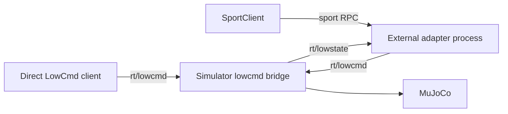
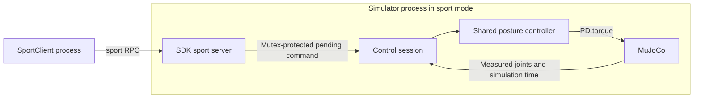

# Current Design

As of: 2026-10-19.

## Control Deployments

The C++ simulator supports three mutually exclusive configurations. LowCmd remains the default; service control is limited to Go2 StandUp/StandDown.

| Configuration | Processes | Command owner |
| --- | --- | --- |
| Direct LowCmd | Client + simulator | External LowCmd writer |
| External sport adapter | SportClient + adapter + lowcmd simulator | Adapter converts accepted requests into LowCmd |
| Internal sport server | SportClient + sport simulator | Simulator's posture controller; no LowCmd subscription |

The direct client and adapter are alternative LowCmd writers. Run only one writer per domain.

Run only one sport server per DDS domain. Internal-server and external-adapter deployments must not run together in the same domain.

## Service Contract

- SDK service `sport`, API version `1.0.0.1`.
- DDS RPC channels: `rt/api/sport/request` and `rt/api/sport/response`.
- StandUp API `1004`, StandDown API `1005`; success `0` means accepted, not motion complete.
- Unsupported request/response action APIs return SDK error `3203`.
- Missing, invalid, or stale feedback prevents acceptance and returns `3202`.
- No server produces a client error such as timeout `3104`.
- SDK Move uses a no-reply call: its return code does not expose server rejection. Move and other locomotion actions are not implemented.

Both deployments share `Go2SportServer`, `Go2ControlSession`, and `Go2PostureController` from the common headers. The controller transitions from measured joints to the original example's 12-joint targets over 2 seconds using smoothstep, kp=50, kd=3.5, zero target velocity, and zero feedforward torque. It holds the target afterward. A new command, including a repeated command, restarts from current measured feedback; the last accepted pending command wins before the next tick.

This is a simulation posture controller, not the physical Go2's proprietary locomotion or balance controller.

## Physics and Thread Ownership

- The GUI physics thread owns the bridge and updates it before each physics step under the existing simulation mutex. Paused updates also use that mutex. There is no separate bridge recurrent thread accessing MuJoCo state.
- SDK request callbacks update only mutex-protected command state; they never read or write MuJoCo data.
- The internal controller uses simulation time. Pause freezes trajectory progress. A backwards time reset clears old commands and torque. Model reload destroys the old bridge/service before replacing model/data and creates a fresh bridge afterward.
- The headless loop uses the same bridge and MuJoCo model directly, with one physics owner and no rendering thread.
- The adapter's SDK feedback callback stores measured joints and receive time in the shared session. Its main loop samples the controller and publishes LowCmd every 2ms using a monotonic wall clock.
- The session rejects nonfinite joint feedback. At a feedback age/gap of 500ms it invalidates the command; feedback restoration alone does not resume control. Internal simulation time and external wall time intentionally have different pause semantics.
- The service joins its SDK request worker before destroying callback-owned state. The adapter closes its feedback channel before destroying the session. The legacy LowCmd example explicitly joins its publishing thread on exit.

Stopping adapter publication does not clear a LowCmd already latched by the low-level simulator. There is no implicit command-source arbitration between multiple external writers.

## Bridge and State Publication

The lowcmd bridge applies `tau + kp * (q_target - q) + kd * (dq_target - dq)` to MuJoCo controls. The internal sport mode applies the shared controller's target with the same PD form. GO/HG IDL selection remains available for lowcmd mode. Internal sport requires robot `go2`, GO IDL, and 12 actuators. Bridge construction also rejects models without sufficient motor sensor data for position/velocity/torque indexing.

The bridge publishes joint/IMU LowState and GO-format SportModeState position/velocity. HG additionally publishes BMS and secondary IMU state. Joystick-related publication remains conditional on joystick use. Realtime publisher updates require a successful trylock before unlockAndPublish.

The headless path loads XML scenes, supports finite wall-clock duration, and does not apply the optional GUI elastic band. Publication rate follows physics updates and available publisher capacity, rather than an independent 1kHz wall-clock thread. Existing GO/HG lowcmd configuration defaults remain unchanged.

## Build, Execution, and Verification

See the [README](../readme.md#go2-sport-service-c-only) for build and launch commands. The original interactive LowCmd example and positional network argument remain supported. New flags select API/action, DDS domain/network, automatic startup, and finite duration.

Tests include controller/session behavior, real SDK RPC dispatch, configuration/CLI checks, actual bridge pause/reset/model recreation/shutdown, and a process runner that evaluates actual DDS joint/height feedback. Test domains must be separate from existing sessions. Generated sensor CSVs, process logs, and JSON evidence live under the runner's output directory.

For requirements, decisions, measured verification results, and maintenance details, see the [completed feature record](completed/01_go2-sport-service-modes.md).
