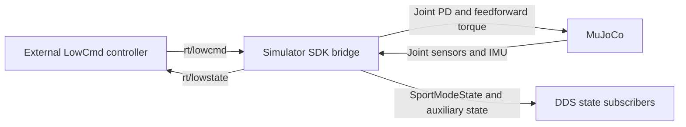

# Current Design

As of: 2026-10-19. This document describes the existing implementation. The service extension is still planned.

## Components and Data Flow

- The C++ simulator initializes the DDS ChannelFactory and creates a GO or HG bridge according to robot/IDL configuration.
- The bridge applies `tau + kp * (q_target - q) + kd * (dq_target - dq)` from LowCmd to MuJoCo control inputs.
- It fills LowState with joint and IMU feedback. Position and velocity are published as GO-format SportModeState.
- The HG bridge also publishes BMS and secondary IMU state. Joystick-related state is published when enabled.
- The current C++ example publishes Go2 StandUp/StandDown joint trajectories using GO LowCmd.
- The bridge currently runs in a separate recurrent thread. Synchronization of MuJoCo state shared with the physics loop needs review during the extension.

## Current Service API Support

The SDK SportClient sends RPC requests. The generic SDK Server provides transport and dispatch to registered handlers. The current simulator does not instantiate a sport server, register StandUp/StandDown handlers, or start that service.

Static checks performed on 2026-10-19:

- GO StandUp/StandDown call `Client::Call()` with API IDs `1004`/`1005`. Original archive disassembly agrees with reconstructed C++.
- The generic server starts through an explicit `Start()` call. An unregistered API returns error `3203`.
- The current build links `/usr/local/lib/libunitree_sdk2.a`. Its SHA-256 matches the user-supplied SDK archive: `08402aea74150dfbfc3fbfded4ca746916a8d892b54d2bade0cbf392a3be4029`.
- SDK Server, ServerBase, ServerStub, and GO SportClient symbols were not found in the current simulator executable.
- `go2.h` indirectly includes MotionSwitcherClient, but the bridge does not invoke that service.

These are static findings, not Service API runtime test results. Recheck them if the binaries change.

## Work in Progress

See the [requirements](req/2026-10-19-go2-sport-service-modes.md) and [implementation plan](plan/2026-10-19-go2-sport-service-modes.md) for two Go2 service deployments. The current data-flow diagram does not include the planned server.

After implementation and verification, update this document to the actual architecture, replace these working-document links with the completed record, and delete the feature's req/plan/wip documents.
