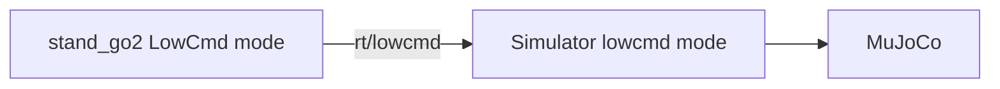
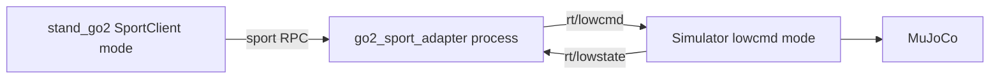
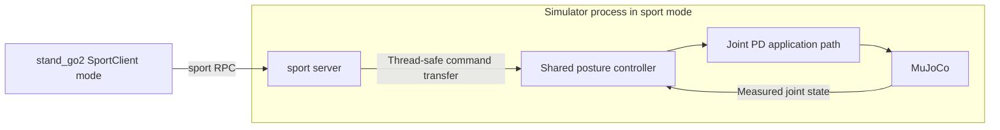

# Go2 StandUp/StandDown Service Deployments — Requirements

Created: 2026-10-19
Status: Awaiting user review / not implemented
Slug: `go2-sport-service-modes`
Related: [current design](../design.md), [implementation plan](../plan/2026-10-19-go2-sport-service-modes.md)

## 1. Purpose and Scope

Preserve existing LowCmd-based Go2 joint control while enabling simulation posture changes through the actual Unitree SDK `SportClient::StandUp()` and `StandDown()` methods. Support a service server inside the simulator and an external adapter process, and verify both using real MuJoCo/DDS execution.

These are alternative deployments of the same service, sharing the service contract and posture controller.

This is simulation posture control based on the existing example, not a reconstruction of the physical Go2's proprietary locomotion or balance controller. Sport APIs for other robots, other actions such as Move/RecoveryStand, and physical robot execution are outside scope.

## 2. Established Baseline

The current simulator receives LowCmd and publishes sensor state but provides no sport service. The SDK archive includes RPC clients and generic server infrastructure; it does not automatically install MuJoCo StandUp/StandDown behavior. Static evidence is recorded in the [current design](../design.md).

Existing user changes in `simulate/CMakeLists.txt` and the untracked `_test/` directory must be preserved and distinguished from this work. Do not modify SDK binaries, headers, or reconstructed sources.

## 3. Deployments and Command Ownership

### A. Existing LowCmd Control

Run without a service server, as before. This remains the default.

### B. External Adapter

Run three processes. The simulator needs no service-handling changes for this deployment. The adapter uses fresh LowState feedback to generate a posture trajectory and LowCmd. The client must not bypass the service by publishing LowCmd itself.

### C. In-Process Simulator Server

Run two processes. In sport mode, the simulator does not use external LowCmd as its control input. Service callbacks do not access physics data; the control/physics loop owns that access.

Operate one sport server and one LowCmd writer per DDS domain. Running the internal server and external adapter together is unsupported. Do not assume DDS automatically prevents duplicate servers; explain this constraint in usage documentation.

## 4. Functional Requirements

| ID | Requirement |
| --- | --- |
| R1 | Preserve the existing stand_go2 LowCmd default and invocation compatibility. Add noninteractive and finite-duration execution for automated testing. |
| R2 | Support `--api lowcmd|sport`, explicit DDS domain/network, and `standup|standdown|sequence` actions. Sport mode must not create a LowCmd publisher. |
| R3 | Support simulator `--control lowcmd|sport`, defaulting to lowcmd. Existing YAML without the new key must remain valid. Permit sport mode only for a Go2 GO-IDL 12-joint model; reject other configurations clearly. |
| R4 | Provide a standalone go2_sport_adapter executable for use with simulator lowcmd mode. Allow explicit DDS domain/network selection. |
| R5 | Both deployments use SDK Server with service name `sport`, version `1.0.0.1`, StandUp ID `1004`, and StandDown ID `1005`. Unsupported action APIs return SDK error `3203`. |
| R6 | RPC result `0` means request acceptance, not physical completion. Confirm posture through LowState/position feedback. Print RPC errors and exit unsuccessfully on failure. |
| R7 | Share the existing example's 12-joint up/down targets. Transition from measured posture using a 2.0-second smoothstep. Initial design values: `dq_target=0`, `kp=50`, `kd=3.5`, `tau=0`. Hold the target after transition completion. |
| R8 | A new command during motion restarts the transition from the current measured posture. Define repeated-command behavior and avoid races between callbacks. |
| R9 | The adapter must neither accept commands nor publish control before the first valid LowState. Reject commands and stop publishing when feedback is at least 500ms old. Report unready/stale state with SDK server-internal error `3202` and logs. Reconnection must not resume control until a new command arrives. |
| R10 | The internal server accepts requests only after initialization and model validation. Progress trajectories using simulation time so pause also pauses motion progress. Invalidate active commands on model reload/time reset and prepare safely again. |
| R11 | The external adapter uses a monotonic wall-clock control loop. Its pause behavior therefore differs from the internal deployment. Run its physical acceptance checks without pausing the simulator. |
| R12 | Initialize external LowCmd headers, motor modes, and CRC compatibly with the existing example. Use a 2ms external control period and the existing bridge period internally; do not promise hard real-time scheduling. |

## 5. Verification and Acceptance Criteria

Reference environment: Linux x86_64, C++17, CMake, the installed Unitree SDK2, and the repository's default Go2 scene. Use the user-specified `simulate/build/` directory. Run test processes sequentially on `lo` in a separate DDS domain.

| ID | Check and acceptance criterion |
| --- | --- |
| V1 | Build the simulator, C++ example, and adapter successfully; pass unit tests and preserve existing user CMake changes. |
| V2 | With the original simulator, a SportClient-only baseline returns a nonzero RPC result. Retain this as runtime evidence that linking the library does not start the server automatically. |
| V3 | Execute actual MuJoCo StandUp then StandDown through direct LowCmd, external adapter, and internal server. For each posture, measured 12-joint target RMSE must be at most 0.15rad. StandUp body height must exceed StandDown height by at least 0.08m. Reach each posture within 8 seconds of request/transition start and evaluate the last 0.5 seconds of samples. NaN, divergence, or overturning fails the test. |
| V4 | In both service deployments, verify StandUp/StandDown result `0`, unsupported API result `3203`, client-only failure, and invalid CLI/model rejection. |
| V5 | Verify adapter missing feedback, 500ms timeout, and new-command requirement after reconnect; internal LowCmd exclusion; command reversal; and time reset handling. |
| V6 | Existing C++ GO/HG configurations still build and initialize in lowcmd mode. Do not install the Go2-only service for HG. |
| V7 | Record commands, executable/SDK identity, domain, RPC results, joint RMSE, heights, timing, exit results, and log locations in completed. State whether a UI was used and identify the physics model. |

The monitor subscribes to `rt/lowstate` and `rt/sportmodestate` and measures actual sensor feedback. Logging commanded targets or RPC success alone cannot satisfy V3. If no display is available, add headless execution to the same simulator and run actual MuJoCo/DDS. If gains or transition duration need tuning, record the measurements and update req/plan; do not merely relax acceptance thresholds.

## 6. Documentation Deliverables and Cleanup

Write agent configuration and all project documentation in English. Keep agent instructions focused on common principles rather than a detailed source-tree inventory.

After implementation and verification, consolidate the requirements, final design, decisions, deviations, process counts, startup order, commands, shared components, extension points, and observed results into `docs/completed/01_go2-sport-service-modes.md`. Update permanent design and usage documentation and replace links to transient files. Then delete all req, plan, and wip documents for this slug. Keep only the completed record from this feature's working-document lifecycle; retain the permanent current design and usage documents.

Do not create a completed record or delete working documents before actual implementation completion. Do not report unverified functionality as complete. Do not commit without a user request.
